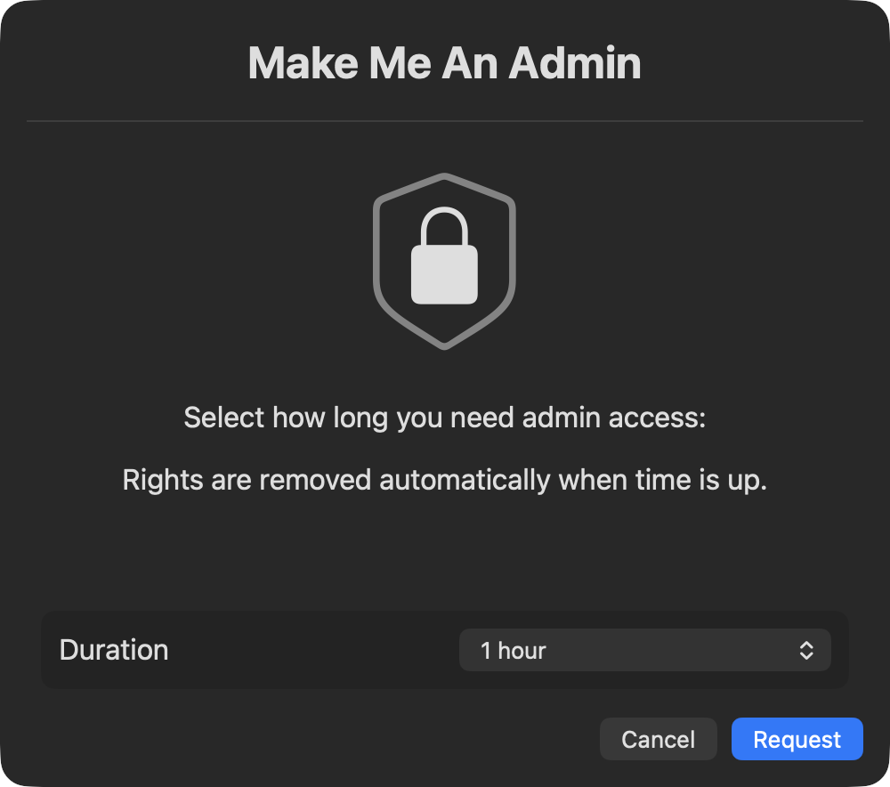
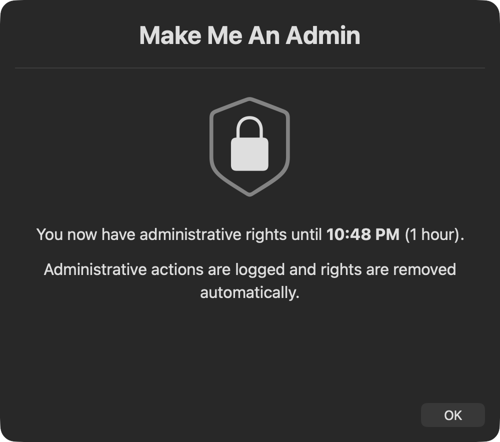

# MakeMeAnAdmin (SwiftDialog Edition)
Repo: [https://github.com/MrNRod/MakeMeAnAdmin.git](https://github.com/MrNRod/MakeMeAnAdmin.git)

A modernized fork of [Jamf's MakeMeAnAdmin](https://github.com/jamf/MakeMeAnAdmin) that gives a standard user **temporary admin rights** and removes them automatically. It is built for **[Fleet](https://fleetdm.com)** first, and also runs from **Jamf Pro**, **Workspace ONE**, or any tool that can run a script as root. The interface is [SwiftDialog](https://github.com/swiftDialog/swiftDialog).

---

## Features

- **Fleet-native deployment**: self-service for end users, a configuration profile for branding, and policies that keep it honest
- **SwiftDialog UI** with company branding that adapts to square, wide and tall logos
- **Time-boxed elevation** (30 minutes to 1 week), one active grant at a time
- **Fail-closed demotion**: the demotion daemon is installed and verified *before* the user is elevated, and any failure rolls the grant back
- **Expiry by wall-clock timestamp**: survives sleep, shutdown and reboot; a backwards clock change demotes immediately
- **MDM backstop** (`enforce` mode) that re-arms a tampered daemon
- **Audit trail**: CSV event log, sudo command log for the session, unified-log entries, and a report of any admin accounts added during the window
- **Dark-mode logo variant**, remote (https) logos and a built-in fallback icon

---

## Screenshot Preview

### Time Selection Prompt


### Confirmation or Active Status Dialog


---

## Requirements

- macOS 12 or later
- Run as **root** by your MDM
- **SwiftDialog installed on the Mac before the script runs** (see below)

### SwiftDialog: required, not installed by the script

Earlier versions downloaded and installed SwiftDialog at run time. That is removed on purpose:

| Problem with run-time install | Why it matters |
| :--- | :--- |
| Downloaded to a predictable path in `/tmp` and installed **as root** | A local user could swap the package and get root. |
| Unpinned "latest" release fetched from the internet by a root script | Supply-chain exposure; breaks offline or behind proxies; results vary per Mac. |
| Installs software as a side effect of a user clicking a button | Not auditable or change-controlled. |

Deploy SwiftDialog through your MDM as its own package, pinned to a version you have tested. At run time the script does **not** trust `PATH` or `/usr/local/bin/dialog`. It calls `/Library/Application Support/Dialog/Dialog.app/Contents/MacOS/dialogcli` directly and requires the bundle to pass `codesign --verify` with Team ID `PWA5E9TQ59`. If SwiftDialog is missing or fails the check, the script exits non-zero without changing anything.

### No separate install step for the script itself

The script is self-provisioning: when a grant is approved it writes a root-owned helper and LaunchDaemon, and when the grant ends it removes them. Nothing privileged stays on the Mac between grants, so there is nothing to install, patch or leave behind. Just deploy the script.

---

# Deploying with Fleet (recommended)

## How Fleet runs it

Fleet runs `.sh` scripts on macOS **as root** and does not pass arguments, so (unlike Jamf) there are no `$4`-style parameters. This project handles that three ways:

| Need | Fleet approach |
| :--- | :--- |
| Company name / logo | A **configuration profile** sets managed preferences that the script reads (step 2). |
| An end user asks for admin | A **self-service script-only package**: the user clicks it in Fleet Desktop (step 3). |
| Run the `enforce` backstop | A second copy of the script with `defaultMode="enforce"`, run by a **policy automation** (step 4). |

| Capability | Fleet tier |
| :--- | :--- |
| Run the script on demand (UI **Actions → Run script**, or `fleetctl run-script`) | Not marked Premium in Fleet's docs |
| Self-service script for end users | Fleet **Premium** |
| Policy automation that runs a script (`run_script`) | Fleet **Premium** |
| Policy automation that installs software (`install_software`) | Fleet **Premium** |

Without Premium it still works: an admin runs the script on demand from the host page when a user asks, and the user sees the prompt on their screen. That makes it an *admin-approved* workflow instead of self-service.

## Step 1: Deploy SwiftDialog

Add the SwiftDialog `.pkg` as a Fleet software package and install it with a policy. The policy checks for the real binary, so it does not depend on Fleet's app inventory (SwiftDialog installs under `/Library/Application Support`, which inventory may not scan).

`lib/software/swiftdialog.yml`
```yaml
# Pin to a release you have tested, and keep the hash.
url: https://github.com/swiftDialog/swiftDialog/releases/download/v<version>/dialog-<version>-<build>.pkg
hash_sha256: <shasum -a 256 of that pkg>
```

Policy (in your fleet's YAML):
```yaml
policies:
  - name: SwiftDialog is installed
    platform: darwin
    query: "SELECT 1 FROM file WHERE path = '/Library/Application Support/Dialog/Dialog.app/Contents/MacOS/dialogcli';"
    install_software:
      package_path: ../lib/software/swiftdialog.yml
```

A Fleet-maintained SwiftDialog app may also be available in your Fleet version (`fleet_maintained_app_slug: swiftdialog/darwin`). If you use it, keep the policy above so installation is judged by the binary the script actually needs.

## Step 2: Branding via a configuration profile

Because Fleet cannot pass parameters, the script reads **managed preferences** from `/Library/Managed Preferences/com.makemeanadmin.plist`. Deploy [`examples/fleet/makemeanadmin.mobileconfig`](examples/fleet/makemeanadmin.mobileconfig) as a custom configuration profile:

```yaml
controls:
  macos_settings:            # key names vary by Fleet version (see "Check against your Fleet version")
    configuration_profiles:
      - path: ../lib/profiles/makemeanadmin.mobileconfig
```

| Key | Description |
| :--- | :--- |
| `companyName` | Letters, digits, `.`, `_`, `-`. Used in the LaunchDaemon label. |
| `companyLogo` | An **`https://` URL** or an absolute path on the Mac. |
| `companyLogoDark` | Optional dark-mode variant (same rules). |

Fleet cannot ship a logo file with a script, so an `https://` URL is the easy route: the script downloads it once, as the user, into a private temp folder, and **checks the file type by content** (PNG, JPEG, GIF, SVG, PDF or TIFF only; anything else falls back to the built-in icon). Host the logo somewhere your Macs can reach. The profile file is only trusted when it is owned by root, which `/Library/Managed Preferences` is.

Generate your own `PayloadUUID` values for the profile (`uuidgen`) instead of reusing the example's.

## Step 3: Let users request admin (self-service) — Fleet Premium

Publish the script as a **script-only package** and turn on self-service.

`lib/software/makemeanadmin.yml`
```yaml
# Pin to a tag or commit so what runs is what you reviewed.
url: https://raw.githubusercontent.com/MrNRod/MakeMeAnAdmin/<tag-or-commit>/MakeMeAnAdmin.sh
hash_sha256: <shasum -a 256 MakeMeAnAdmin.sh at that tag>
pre_install_query:
  path: ./swiftdialog-present.sql
```

`lib/software/swiftdialog-present.sql`
```sql
SELECT 1 FROM file WHERE path = '/Library/Application Support/Dialog/Dialog.app/Contents/MacOS/dialogcli';
```

Your fleet's YAML:
```yaml
software:
  packages:
    - path: ../lib/software/makemeanadmin.yml
      self_service: true
```

Users then open **Fleet Desktop → My device → Self-service** and click it. The pre-install query keeps it from running before SwiftDialog is present. Script-only packages cannot be installed automatically, which is what you want here: only a person asking should trigger the prompt.

**Without Premium:** upload `MakeMeAnAdmin.sh` under **Controls → Scripts** and run it from the host's **Actions → Run script** (or `fleetctl run-script --script-path=MakeMeAnAdmin.sh --host=<hostname>`) when someone asks. The prompt appears for whoever is logged in.

## Step 4: Keep it honest with the `enforce` backstop — Fleet Premium

While elevated, a user is an administrator and could remove the demotion daemon (see [Security Model](#security-model)). `enforce` mode re-arms it, and demotes immediately if the grant has expired. Fleet scripts take no arguments, so create a second copy with a different default mode:

```bash
sed 's/^defaultMode="request"/defaultMode="enforce"/' MakeMeAnAdmin.sh > lib/scripts/MakeMeAnAdmin-enforce.sh
grep '^defaultMode=' lib/scripts/MakeMeAnAdmin-enforce.sh   # must print defaultMode="enforce"
```

Do this in CI so the copy never drifts from the original. Keep the enforce copy as a **plain script**, not a self-service item.

```yaml
controls:
  scripts:
    - path: ../lib/scripts/MakeMeAnAdmin-enforce.sh

policies:
  - name: MakeMeAnAdmin - no expired or tampered grants
    platform: darwin
    # PASSES when there is no grant, or the grant is active and its daemon file exists.
    # FAILS (and runs the enforce script) when the grant has expired or the daemon was removed.
    query: |
      SELECT 1 WHERE NOT EXISTS (
        SELECT 1 FROM file_lines
        WHERE path = '/Library/Application Support/MakeMeAnAdmin/state'
          AND line LIKE 'expiry=%'
          AND (
            CAST(substr(line, 8) AS INTEGER) <= CAST(strftime('%s','now') AS INTEGER)
            OR NOT EXISTS (SELECT 1 FROM file WHERE path LIKE '/Library/LaunchDaemons/com.%.adminExpiryCheck.plist')
          )
      );
    run_script:
      path: ../lib/scripts/MakeMeAnAdmin-enforce.sh
```

`enforce` is idempotent and does nothing to an active, healthy grant, so an occasional extra run is harmless. The automation script has to be defined in the same fleet as the policy. Note Fleet retries policy-script automations a limited number of times, so also rely on the daemon itself, which checks every 60 seconds.

**Without Premium:** keep the policy and use its failing-hosts list as an alert. Run the enforce script on those hosts on demand.

## Step 5: Watch for admins you did not expect (alert only)

```yaml
policies:
  - name: MakeMeAnAdmin - only approved accounts are admins
    platform: darwin
    # Edit the list to your break-glass / IT accounts. A user mid-grant will FAIL this on purpose.
    query: |
      SELECT 1 WHERE NOT EXISTS (
        SELECT 1 FROM users u
        JOIN user_groups ug ON ug.uid = u.uid
        JOIN groups g ON g.gid = ug.gid
        WHERE g.groupname = 'admin' AND u.username NOT IN ('root', 'itadmin')
      );
```

Do **not** attach an automation to this one: it fails for legitimate grants and cannot tell which are approved. Use it for reporting, together with the `unexpected-admin-added` and `tamper-detected` events in the log.

## Check against your Fleet version

Fleet changes quickly. These details come from Fleet's public docs and have not all been confirmed against a live server, so check them for your version:

- **YAML key names** have moved between releases (for example `macos_settings` vs `apple_settings` for profiles, and `teams/` vs `fleets/` folders). Use the names in the GitOps docs for your version.
- **Script timeout and output limits** are not stated in the Fleet documentation. The prompt closes after 120 seconds by design (`promptTimeout`), well inside a typical limit.
- **Managed preferences from a custom profile.** The profile uses a standard preference-domain payload (domain `com.makemeanadmin`). It lints cleanly, but confirm on a test Mac that `/Library/Managed Preferences/com.makemeanadmin.plist` appears after Fleet delivers it.
- **Fleet-maintained SwiftDialog** availability and slug.

A good first test: deliver everything to one Mac, run `./MakeMeAnAdmin.sh preview` as a normal user to check branding, then do a real grant with a 30-minute window and confirm both the demotion and a reboot-during-grant.

---

# Other MDMs

## Jamf Pro

Add the SwiftDialog package and `MakeMeAnAdmin.sh` to one policy (packages install before scripts) and expose it in **Self Service**. Jamf passes parameters as `$4`–`$8`:

| Variable | Jamf Param | Description | Default |
| :--- | :--- | :--- | :--- |
| `companyName` | `$4` | LaunchDaemon label component. | `MrNRod` |
| `companyLogo` | `$5` | Absolute path or `https://` URL. | built-in lock icon |
| *(unused)* | `$6` | Was `allowDialogInstall`. Ignored. | |
| `companyLogoDark` | `$7` | Optional dark-mode logo. | none |
| `mode` | `$8` | `request`, `enforce` or `preview`. | `request` |

For the backstop, create a second policy with the same script and `$8 = enforce`, triggered by **Recurring Check-in**, frequency **Ongoing**.

## Workspace ONE UEM

Upload the script (**Resources → Scripts**, shell, run as System context) and define script variables. They are passed as environment variables:

```
companyName=Acme
companyLogo=https://example.com/brand/logo.png
companyLogoDark=
mode=request
```

Deploy the SwiftDialog package as an app assigned to the same smart group first. For the backstop, assign a second copy of the script with `mode=enforce` on a recurring schedule.

## Manually

```bash
sudo companyLogo="/path/to/logo.png" ./MakeMeAnAdmin.sh            # request
sudo ./MakeMeAnAdmin.sh enforce
companyLogo="/path/to/logo.png" ./MakeMeAnAdmin.sh preview         # no root, changes nothing
```

---

# Configuration reference

Precedence, highest first:

1. **Script parameter** (`$4`, `$5`, `$7`, `$8`): Jamf Pro
2. **Environment variable** (`companyName`, `companyLogo`, `companyLogoDark`, `mode`): Workspace ONE, manual runs
3. **Managed preference** (`com.makemeanadmin`): Fleet and any other MDM that can deliver a profile
4. **Built-in default**

`mode` can also be given as the script's first argument (`request`, `enforce`, `preview`), or changed for a copy of the script by editing the `defaultMode` line.

## Logos: wide, square and tall

SwiftDialog sizes an icon by *width* and lets the height follow, and the window height is fixed. The script reads the logo's pixel dimensions and picks both so any shape looks balanced:

| Logo shape | Example | Drawn size |
| :--- | :--- | :--- |
| Square | 512×512 | 110×110 |
| Wide 3:1 | 900×300 | 330×110 |
| Wide 5:1 | 1500×300 | 380×76 |
| Very wide 10:1 | 2000×200 | 380×38 |
| Tall 1:2 | 300×600 | 55×110 (fits a 110×110 box) |
| Small raster | 96×96 | 96×96 (never upscaled past 1×) |

The window is 500 pt wide and 350–480 pt tall depending on the logo. Recommendations:

- Use a **transparent PNG, SVG or PDF**, about **2× the drawn size** (for example 760×220 for a 3.5:1 logo) so it is sharp on Retina displays.
- Trim excess transparent padding from the image; it counts toward the logo's shape.
- Local paths and `https://` URLs are both measured. If a logo cannot be read or downloaded, the built-in icon is used and a warning is logged.
- The sizing constants are at the top of the script (`logoMaxW`, `logoMaxH`, `winWidth`) if you want to tune them.

## Previewing your branding

```bash
companyLogo="/Library/Application Support/Acme/logo.png" ./MakeMeAnAdmin.sh preview
```

`preview` needs no root, shows the real prompt and confirmation dialogs, and changes nothing. Use it to check a new logo before you ship it.

---

## How It Works

1. Finds the console user (never `root`/`loginwindow`) and verifies SwiftDialog.
2. Refuses if the user is already an admin (so they are never demoted by mistake) or already has an active grant (so a grant cannot be extended by re-running it).
3. Shows the duration prompt. The answer must match the fixed list; anything else is rejected.
4. **Arms first**: writes the state file, a root-owned helper and the LaunchDaemon, and confirms `launchd` loaded it.
5. Only then adds the user to `admin` and confirms the membership. If any step fails, or the script is killed part-way, the grant is rolled back.
6. The daemon runs at boot and every 60 seconds. At expiry it removes the user (retrying if needed), logs the session's sudo commands, reports any accounts that were added to `admin` during the window, then deletes itself and all state.

---

## Security Model

### What it defends against

| Bypass attempt | Defence |
| :--- | :--- |
| Re-run the script to extend the window | Rejected while a grant is active. |
| Move the system clock back | `lastSeen` is recorded every minute; a backwards step over 2 minutes demotes immediately. |
| Edit the expiry to a far-future date | The helper rejects any grant longer than one week and demotes. |
| Stay admin through a reboot or sleep | Expiry is an absolute timestamp; the daemon has `RunAtLoad`. |
| Delete or unload the daemon | `enforce` mode (Fleet policy automation, or your MDM's schedule) re-arms it and demotes if expired. Files are also `schg`-flagged to slow casual removal. |
| Demotion fails transiently | Retried up to three times, then the daemon stays armed and `launchd` retries every minute. |
| Be left admin because setup failed | Daemon is verified before elevation; failures roll back. |
| Demoting the wrong person | The target user is stored in the state file at grant time, not looked up at expiry. |
| Inject through `companyName`, usernames, logo URLs or the dialog result | All are validated against strict patterns; durations come from a fixed whitelist; logos must be `https://` and are type-checked by content. |
| Swap the SwiftDialog installer / binary | No run-time install; signature and Team ID are verified; `PATH` is fixed. |
| Hide what they did | Sudo commands are logged for the window; admins added during it are reported. |

### What it cannot do (read this)

**While elevated, the user is an administrator and can run anything as root.** No script can stop a determined admin from, for example, unloading the daemon and clearing the `schg` flag, creating a second admin account, or editing `/etc/sudoers`. This tool makes that hard, noisy and self-healing, but the real backstop is your MDM:

1. **Run `enforce` on a schedule or on failure.** With Fleet that is [step 4](#step-4-keep-it-honest-with-the-enforce-backstop--fleet-premium). It re-arms a removed daemon and demotes expired grants even if the daemon was killed.
2. **Alert on the audit events**: `tamper-detected`, `demote-failed`, `unexpected-admin-added`, `state-tampered` and `clock-rewound` in `MakeMeAnAdminEvents.log`.
3. **Report unexpected members of the local `admin` group** ([step 5](#step-5-watch-for-admins-you-did-not-expect-alert-only)).

### Privacy note on sudo logging

Older versions enabled `log_input,log_output` for all sudo users, which records everything typed (including secrets) and grows without limit. This version logs **commands only** (`/var/log/sudo_admin.log`, root-readable), validates the sudoers snippet with `visudo -c` before installing it, and replaces the old snippet on the next run.

---

## Log Events

`MakeMeAnAdminEvents.log` (CSV, `root:wheel 640`, rotated at 1 MB into the archive CSV). Events are also written to the unified log under the tag `MakeMeAnAdmin`.

| Event | Meaning |
| :--- | :--- |
| `elevated` | Grant started. |
| `demoted` | Grant ended; `command` holds the reason and the user's sudo commands. |
| `demote-failed` | Demotion did not take; will retry. |
| `unexpected-admin-added` | Accounts added to `admin` during the window. |
| `tamper-detected` | `enforce` found the daemon missing or unloaded. |
| `state-invalid` | State file was corrupt; nothing could be safely demoted. |

---

## File Locations

- **Logs**: `/Library/Logs/MakeMeAnAdmin/MakeMeAnAdminEvents.log` and `..._Archive.csv`
- **Sudo audit log**: `/var/log/sudo_admin.log`
- **Managed preferences (Fleet / profile)**: `/Library/Managed Preferences/com.makemeanadmin.plist`
- **State / helper (only while a grant is active)**: `/Library/Application Support/MakeMeAnAdmin/`
- **LaunchDaemon (only while a grant is active)**: `/Library/LaunchDaemons/com.<companyName>.adminExpiryCheck.plist`

---

## Upgrading from earlier versions

- **SwiftDialog is no longer installed for you.** Deploy it first. `$6` / `allowDialogInstall` is ignored.
- Older versions did not demote reliably (the generated expiry script never expanded its paths), so users elevated by the old version may still be admins. Run `enforce` once, or check your admin group.
- The old `log_input,log_output` sudoers snippet is replaced on the next grant.
- `/etc/sudoers.d/admin_logging` is owned by this tool; if you maintain a snippet of the same name, rename one of them.
- The prompt now closes after 120 seconds (it was 300) so MDM script timeouts do not hit first.

---

## Comparison to Original

| Feature                         | Original Jamf Version | SwiftDialog Edition |
|---------------------------------|------------------------|----------------------|
| GUI Support                     | ❌                     | ✅ SwiftDialog |
| MDM Compatibility               | Jamf Only              | ✅ Fleet, Jamf, Workspace ONE, any |
| Branding Support                | ❌                     | ✅ any logo shape + dark variant + https logos |
| Time-based UI Selection         | ❌ Manual via CLI      | ✅ |
| Logging                         | Basic                  | ✅ CSV + sudo commands + unified log |
| Survives sleep / reboot         | ✅ (sleep-based timer) | ✅ (timestamp-based) |
| Clock-tamper detection          | ❌                     | ✅ |
| Fail-closed grant / rollback    | ❌                     | ✅ |
| MDM re-arm / enforcement mode   | ❌                     | ✅ |

---

## Credits

- Based on [Jamf's MakeMeAnAdmin](https://github.com/jamf/MakeMeAnAdmin)
- SwiftDialog by [Bart Reardon](https://github.com/swiftDialog/swiftDialog)
